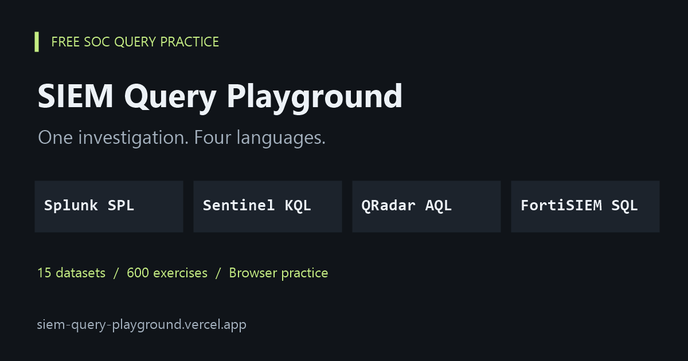

# SIEM Query Playground

An English browser query playground for Splunk SPL, Sentinel KQL, QRadar AQL, and FortiSIEM Advanced Search SQL. The same supplied evidence can be investigated in all four languages.

**[Try the live playground](https://siem-query-playground.vercel.app/)** · [Report an issue](https://github.com/zyadelzyat/siem-query-playground/issues)



## Free queries and language references

Choose **Free query** to execute any supported query without an exercise or grading. Its initial source is a separate, explicitly synthetic scratch table of five rows. Edit the JSON and apply it to try your own data (1–1,000 objects with timezone-aware `time` values), or choose an imported dataset. Scratch data remains in the browser; it does not modify any evidence file. Each mode, source, and language retains its own query draft. Returning to Guided practice restores the previous capture and exercise. Scratch queries never earn exercise progress.

The editor links directly to the selected language's official documentation. **Cheat sheet** compares 26 common operations across all four languages, including filter, boolean conditions, text search, projection, counts, grouping, thresholds, sorting, limits, and time windows. Nineteen operations have runnable full-query examples with **Try in free query** buttons. Native-only examples (distinct/deduplication, SUM, AVG, MIN, MAX, renaming, distinct counts) are clearly marked and link to the full references. Native support does not mean the operation is implemented by this browser engine. Approximate distinct counting is distinguished from exact counting.

Search the cheat sheet by operation or syntax, filter it by lab support, or download its complete comparison as Markdown. The cheat sheet uses the currently selected dataset's field names and example values. These mappings are learning aids, not a guarantee of identical native engine semantics.

## Supplied data

The application imports **121,606 records from 15 datasets** from the public Security Datasets collection: Windows JSON/NDJSON, AWS CloudTrail JSON, an S3 CSV, and Linux audit text logs. There are no synthetic authentication records in the application.

The imported evidence comes from [Security Datasets](https://securitydatasets.com/introduction.html) / [Open Threat Research Forge](https://github.com/OTRF/Security-Datasets). See [dataset attribution and licensing](THIRD_PARTY_NOTICES.md). The explicitly synthetic scratch sample in Free query is separate from the imported evidence.

All JSON records and Linux audit lines retain their original content (excluding line terminators). CSV rows retain every original column value in a JSON object. The original files are never changed. Each Linux audit line is one query row; related audit lines are not reconstructed into a single event.

See [the data manifest](dist/datasets/manifest.json) for source-relative filenames, SHA-256 checksums, record counts, time bounds, missing-value counts, event types, and exclusions. ZIPs duplicate extracted source files; `__MACOSX` entries are metadata. The two packet captures are inventoried but not queried, because they need packet decoding first. No sample is silently dropped from the 15 supported text datasets.

`prepare_logs.py` regenerates the compressed datasets from the supplied directory. It uses only the Python standard library. Import errors stop preparation instead of silently discarding a record. Approximately 7 MB of compressed datasets are loaded one at a time, on demand, using a browser worker and `DecompressionStream('gzip')`.

## Run and verify

From this project directory:

```powershell
python -m http.server 4173 --bind 127.0.0.1 --directory dist
```

Open [the local lab](http://127.0.0.1:4173). It must be served over HTTP because the application uses ES modules and a worker. A current browser with DecompressionStream support is required. Guest practice works without a backend. Account features require the hosted API. Google Fonts is optional, with system font fallbacks.

```powershell
node --test tests/*.test.mjs
```

Tests use all 15 imported datasets and all 600 reference solutions. They check cross-language equivalence, grading on actual captures, time boundaries, unknown fields, unsupported syntax, string matching, aliases, missing fields, and original-record preservation through the adapters. Small synthetic fixtures exist only in tests to exercise exact boundary conditions; they are not shipped as training data.

## Educational schemas and language limits

The interpreter supports a bounded subset, not the vendor engines. It never evaluates a query as JavaScript. Platform tables are training views: `index=lab`, `LabEvents`, `events`, and `fsiem.events`. In particular, `LabEvents` is a custom table rather than a claim that all source formats belong in Sentinel's SecurityEvent table.

| Meaning | SPL | KQL | AQL | FortiSIEM |
| --- | --- | --- | --- | --- |
| Timestamp | _time | TimeGenerated | starttime | phRecvTime |
| Source event code | EventCode | EventID | eventid | eventCode |
| Channel + event code | event_type | EventType | eventname | eventType |
| Account | user | Account | username | user |
| Source IP | src_ip | IpAddress | sourceip | srcIpAddrV4 |
| Host | host | Computer | hostname | reptDevName |
| Channel/provider | source | Channel | channel | eventSource |
| Process path | process_path | ProcessName | processname | procName |
| Command line | command_line | CommandLine | commandline | command |
| Original record | _raw | RawEvent | payload | rawEventMsg |

`event_id` is the source record's one-based sequence ID within its dataset. No QRadar QIDs are fabricated. AQL columns, normalized FortiSIEM attributes, and composite event labels are educational mappings; actual deployments require their own parsers and schemas. FortiSIEM here means Advanced Search SQL, not FortiAnalyzer SQL or traditional XML rules.

Windows account precedence is User, TargetUserName, SubjectUserName. Source IP precedence is IpAddress, SourceIp, SourceAddress. Process precedence is Image, NewProcessName, ProcessName, Application. Original records remain available to inspect these choices. Missing fields remain empty strings; no host or account is invented. AWS event codes are event names; Linux event codes are audit record types. Windows EventID remains numeric.

- **SPL:** `index=lab`, `where/search`, `table/fields`, `stats count [as name] [by fields]`, `sort`, `head`. Explicit AND is required. Search wildcard matching is case-insensitive; where equality is case-sensitive. `_time` is an ISO UTC string in this interpreter, not Splunk's epoch representation. No earliest/latest.
- **KQL:** `LabEvents`, `where`, `project`, `summarize count() [by fields]`, `sort/order by`, `take/limit`, `distinct`, `ago(Nm/Nh/Nd)`, `datetime(constant)`. No join, let, bin, or extend.
- **AQL:** SELECT, WHERE, COUNT(*), GROUP BY, HAVING, ORDER BY, LIMIT, LAST N MINUTES/HOURS/DAYS. QIDNAME and UTF8 are not implemented.
- **FortiSIEM SQL:** the same SQL subset, `now()-seconds`, and the educational extraction expression `metrics_string.value[indexOf(metrics_string.name, 'user')]`. Other ClickHouse functions are not implemented.
- **Predicates:** comparisons, AND/OR/NOT, parentheses, IN. String equality is case-sensitive outside SPL search. contains and startswith are case-insensitive. has uses a simplified word-boundary split. LIKE is case-sensitive, ILIKE case-insensitive; only `%` is a wildcard. Null semantics, general coercion, arithmetic, and arbitrary function expressions are not implemented.

Every capture has its own fixed clock: its latest source timestamp. AQL timestamps use Unix milliseconds; FortiSIEM timestamps use Unix seconds. Source timezone offsets are normalized to UTC without replacing the date.

## Exercises and privacy

Ten exercises are generated from each dataset's actual event types, accounts, timestamps, and source text. A text-hunting match is evidence to investigate, not an automatic malicious verdict. Answers are compared on the full capture plus a deterministic subset and a duplication of original records. These are local correctness checks, not a secure anti-cheating exam. Required output column names matter; row order matters only where requested; duplicate rows remain significant.

Queries execute in a worker on the visitor's browser. Public training captures are bundled with the site. Guest progress and drafts stay in localStorage. Signed-in exercise checks also submit the query to a server worker for verification; query text is not saved in account records. Scratch edits stay on the device. Exports contain all result rows; the interface previews the first 150. Source records can be paged and inspected in full.

### Accounts, rankings, and administration

Google Identity Services provides an ID token, verified server-side with Google's public keys using `jose`. The server checks its signature, issuer, audience, recent issue time, expiry, nonce, and verified email. Seven-day opaque sessions are stored as hashed tokens in a private Vercel Blob store. Only the verified email configured in server-only `ADMIN_EMAIL` can access `/api/service?action=admin`; hiding the navigation link is not the access control.

One immutable completion record per user/dataset/language/exercise prevents repeat scoring. A scenario requires all ten exercises in one language; other completed languages add paths and points, not another distinct scenario. Old browser progress does not enter the ranking. The public board exposes pseudonyms and scores, while email and Google name are restricted to the admin dashboard. Scores are practice progress, not an anti-cheating credential.

Visitor metrics count signed, random browser cookies, not exact people. No IP or query text is retained in application records. Counts begin with this release. Account and completion records persist in private storage; sessions expire after seven days. See `dist/privacy.html` for the visitor-facing notice. Per-instance throttling limits accidental bursts but is not a global rate limiter. This implementation lists private records to compute rankings and is intended for a small playground; migrate aggregations to a database if traffic grows.

Production uses `GOOGLE_CLIENT_ID`, `APP_ORIGIN`, `ADMIN_EMAIL`, and `BLOB_READ_WRITE_TOKEN`. Configure these as server environment variables; `.env.example` contains blank placeholders. Attach a **private** Vercel Blob store, configure the Google OAuth Authorized JavaScript origin for your HTTPS domain, and deploy this repository with the supplied `vercel.json`. The build regenerates static language guides from the runnable examples; bundled captures are served directly from `dist/datasets`, without downloading from another website. Set the canonical origin in `deployment/discovery.mjs` if deploying a fork. The static Python development server supports guest practice only; accounts require the hosted API.

Install dependencies with `npm install` (or `pnpm install --frozen-lockfile`), then run `npm test`. Node.js 22 or later is recommended. The compressed sample captures are included; optionally regenerate them with `python prepare_logs.py /path/to/source/logs`.

Contributions are welcome: open an issue with a proposed SOC scenario or an unsupported query, or submit a focused pull request with relevant checks. Include the dataset, language, query, expected result, and actual result when reporting a bug. Keep real credentials and private production logs out of examples. Dataset licensing is covered by [THIRD_PARTY_NOTICES.md](THIRD_PARTY_NOTICES.md) and the bundled upstream MIT notice; no separate license has been declared for the application code.

Public visitor access does not grant editor or owner permissions in the hosting control plane. The project owner alone manages publication; visitors can run queries and change their own browser-local scratch table and progress, without changing shared datasets or other visitors' data.

## References

- [FortiSIEM Advanced Search](https://docs.fortinet.com/document/fortisiem/7.2.1/user-guide/853395/overview)
- [Kusto query reference](https://learn.microsoft.com/en-us/kusto/query/)
- [QRadar AQL](https://www.ibm.com/docs/en/qsip/7.5?topic=search-ariel-query-language)
- [Splunk SPL reference](https://help.splunk.com/en/splunk-enterprise/search/spl-search-reference)
